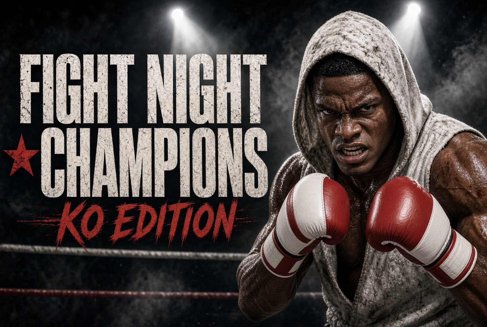

<p align="center"></p>

# Fight Night Champion Recompiled

A work-in-progress native Windows port of **Fight Night Champion** (Xbox 360, 2011) made by **static
recompilation**: the game's PowerPC code is translated to C++ and compiled for x64, then
run on a small runtime that plays the part of the console. Graphics and audio use
[Xenia](https://github.com/xenia-project/xenia)'s GPU and audio emulation; the
recompiler is [XenonRecomp](https://github.com/hedge-dev/XenonRecomp).

It is built on the runtime, launcher and tools of
[WET Recompiled](https://github.com/zonehammer/wet-recomp) and
[Conan Recompiled](https://github.com/zonehammer/conan-recomp).

**This repository contains no game data.** You need your own copy of Fight Night Champion (title ID
`45410915`). The build extracts your disc and generates the C++ on your machine;
nothing derived from the game is ever committed.

## Status

**Playable.** Menus, Champion mode, fights and saving work. Still early: please report
anything that goes wrong with `fightnight.log` (next to the game's exe).

## Features

- Native x64 Windows build of the game's own code, no emulator.
- Higher resolutions (`resolution_scale` 1-3: 720p, 1440p, 4K) with SMAA / FXAA, AMD FSR
  / CAS or NVIDIA Image Scaling, and 16x anisotropic filtering.
- **Frame rate unlock** from 30 up to 360 FPS (F6 cycles in game): only the render loop
  speeds up, the fight simulation keeps the game's fixed 60 Hz.
- Controllers through SDL (Xbox, PlayStation and others), rumble.
- Saves in `game\hdd` with automatic backups; achievements with pop-ups.
- Settings overlay (F1), screenshots (F12), brightness / contrast / gamma / colour.
- Hold **Back** on the pause menu to quit to desktop.
- Launcher with settings and one-click updates.

## Installing (Windows 10/11, 64-bit)

You need your own Fight Night Champion disc image (tested with *Fight Night Champion (USA, Europe)
(En,Fr,De)*), or the folder of an already extracted disc, and about 15 GB of free space.

1. Download **FightNightSetup.exe** from the
   [latest release](https://github.com/zonehammer/fightnight-recomp/releases/latest).
2. Run it, choose your disc image (or extracted folder) and a folder to install to, and press
   **Install**. It downloads the build tools it needs (Git, CMake, Ninja, Clang, Python),
   gets this source code, extracts your disc and builds the game on your PC. The first build
   takes a while (10-30 minutes).
3. Start **Fight Night Champion Recompiled** from the desktop shortcut: the launcher has the settings,
   then press **Play**. In game, F1 opens the settings overlay.

The launcher's **Check for updates** / **Update now** gets and builds new releases; your
saves and settings stay.

## Building by hand

1. Install [Python 3](https://www.python.org/downloads/) (tick "Add python.exe to PATH"),
   [Git for Windows](https://git-scm.com), CMake and Ninja (`pip install cmake ninja`) and
   the latest **llvm-mingw** release (`llvm-mingw-<date>-ucrt-x86_64.zip` from
   [github.com/mstorsjo/llvm-mingw/releases](https://github.com/mstorsjo/llvm-mingw/releases)),
   unzipped with its `bin` folder on your `PATH`.
2. Build:

   ```bat
   git clone --recursive https://github.com/zonehammer/fightnight-recomp.git
   cd fightnight-recomp
   python tools\build.py --iso "D:\path\to\FightNight.iso"
   ```

   This extracts the disc into `game\extracted`, recompiles `default.xex` into
   `generated\ppc` and builds everything.
3. Run `build\runtime\FightNightLauncher.exe` (settings, then Play) or
   `build\runtime\FightNightRecomp.exe`. Problems: include `fightnight.log` (next to the exe).

## How it works

1. `tools/prepare_game.py` extracts the disc into `game/extracted/`.
2. A patched XenonRecomp translates `default.xex` into C++ files in `generated/ppc/`,
   guided by `config/FightNight_config.toml` and `config/FightNight_switch_tables.toml`
   (`tools/fix_switch_bounds.py` sizes functions whose jump tables run past the
   analyser's estimate).
3. `runtime/` provides what the console did: guest memory, threads and synchronisation,
   files, input, achievements and the kernel/XAM functions.
4. The GPU commands the game submits run through Xenia's command processor and shader
   translator; XMA audio is decoded by Xenia's decoder and played with XAudio2.

## Credits

- [XenonRecomp](https://github.com/hedge-dev/XenonRecomp) (hedge-dev): the recompiler.
- [Xenia Canary](https://github.com/xenia-canary/xenia-canary): the resolve readback /
  downscale (fighters' kit colours) and the "Unlock FPS" game patch idea by illusion
  ([game-patches](https://github.com/xenia-canary/game-patches)).
- [Xenia](https://github.com/xenia-project/xenia): GPU and audio emulation, and the
  reference for the console's behaviour.
- [SDL2](https://www.libsdl.org/), [Dear ImGui](https://github.com/ocornut/imgui),
  [FFmpeg](https://ffmpeg.org/), [NVIDIA Image Scaling](https://github.com/NVIDIAGameWorks/NVIDIAImageScaling).

## Legal

Fight Night Champion Recompiled's own code is released under the [MIT licence](LICENSE); the third-party
projects keep their own licences. This project contains no game code or assets and is
intended for people who own a legitimate copy of Fight Night Champion. It is not affiliated
with or endorsed by Electronic Arts or EA Canada. Fight Night Champion is a trademark of its
respective owner.
